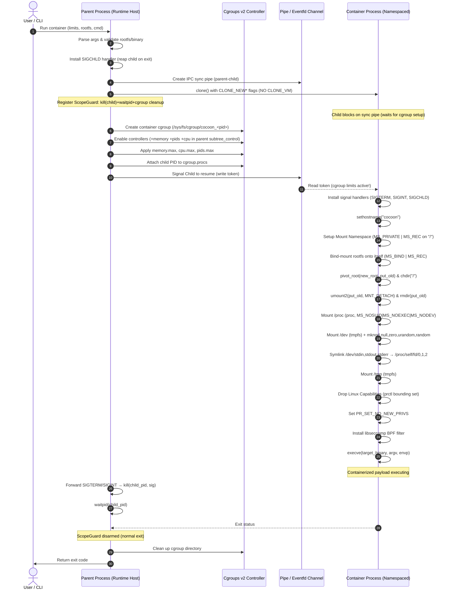

# Architecture & Implementation Plan: cocoon, a Mini Container Runtime in C++17

## 1. Project Overview & Technical Objectives

The goal is to build a lightweight, production-grade Linux container runtime from scratch in **Modern C++17**, demonstrating how standard container engines (like Docker / runc) interact with Linux kernel isolation primitives.

> [!IMPORTANT]
> This runtime **requires root privileges** (`sudo`) to create namespaces with `clone(2)`. This is explicitly documented in the CLI usage and README. A `CLONE_NEWUSER` rootless mode is planned as a stretch goal (see §3.1).

### Core Technical Objectives
- **Process Isolation**: Hands-on usage of Linux Namespaces (`PID`, `Mount`, `UTS`, `Network`, `IPC`).
- **Filesystem Confinement**: Practical implementation of `pivot_root` vs `chroot`, mount propagation (`MS_PRIVATE`), and pseudo-filesystems (`/proc`, `/dev`).
- **Resource Governance**: Programmatic configuration of **cgroups v2** (`memory.max`, `cpu.max`, `pids.max`), including controller delegation.
- **Security Hardening**: Dropping Linux capabilities and building a BPF syscall filter with `libseccomp`.
- **Modern C++ Systems Programming**: Idiomatic C++17 using RAII wrappers for Linux file descriptors, cgroup handles, seccomp filters, and robust error handling with `std::system_error`.

---

## 2. Container Lifecycle & Execution Sequence



---

## 3. Deep-Dive: Core Technical Components & Kernel Primitives

### 3.1 Process Isolation (`clone`)

- **Mechanism**: `clone(2)` with `SIGCHLD | CLONE_NEWPID | CLONE_NEWNS | CLONE_NEWUTS | CLONE_NEWIPC | CLONE_NEWNET`.
- **Stack Allocation**: `clone(2)` requires a dedicated stack memory block. In x86_64, stacks grow downward; we allocate a page-aligned buffer using `mmap(MAP_PRIVATE | MAP_ANONYMOUS | MAP_STACK)` with a guard page (`mprotect(PROT_NONE)`) at the bottom to catch stack overflows cleanly.

> [!CAUTION]
> **Never pass `CLONE_VM`.** Without `CLONE_VM`, the child gets a full copy of the parent's address space (like `fork`), so the custom stack is only used as the initial call frame — the child can safely use the full copied address space. If `CLONE_VM` is accidentally included, parent and child share memory and will corrupt each other's state.

- **PID-1 Responsibilities**: The child process becomes PID 1 inside the new namespace. Inside a PID namespace, PID 1 has **non-standard signal behavior**: `SIGTERM` and `SIGINT` are silently ignored unless an explicit handler is installed. The child **must** install signal handlers for `SIGTERM`, `SIGINT`, and `SIGCHLD` (for reaping orphaned zombie processes) before calling `execve`.

- **Stretch Goal — `CLONE_NEWUSER` (Rootless Containers)**: Adding `CLONE_NEWUSER` allows the runtime to run without `sudo` by mapping UID 0 inside the container to the caller's unprivileged UID on the host (via writing to `/proc/<pid>/uid_map` and `/proc/<pid>/gid_map`). This is how rootless Podman works. Planned as a Phase 6+ extension.

### 3.2 Filesystem Jail (`pivot_root`)

`chroot(2)` is vulnerable to escape (e.g., via open file descriptors to outside directories or re-chroot exploits). `pivot_root(2)` is the standard mechanism used by runc:

1. **Mount Propagation**: Kernel mounts default to `MS_SHARED` in systemd systems. We must execute `mount(nullptr, "/", nullptr, MS_PRIVATE | MS_REC, nullptr)` to prevent container mounts from leaking into the host mount namespace.
2. **Bind-Mount Rootfs**: `pivot_root` requires that `new_root` is a mount point. We satisfy this by bind-mounting the target rootfs directory onto itself: `mount(rootfs, rootfs, "bind", MS_BIND | MS_REC, nullptr)`.
3. **Pivoting**:
   - Create `.old_root` temporary directory inside `new_root`.
   - Call `syscall(SYS_pivot_root, new_root_path, old_root_path)`.
   - Change directory to `/`.
   - Unmount old root using `umount2("/.old_root", MNT_DETACH)` and remove the temporary mount point.
4. **Pseudo-Filesystems**:
   - Mount `/proc`: `mount("proc", "/proc", "proc", MS_NOSUID | MS_NOEXEC | MS_NODEV, nullptr)`.
   - Mount `/dev` via **`tmpfs` + explicit device nodes** (the `runc` approach):
     ```
     mount("tmpfs", "/dev", "tmpfs", MS_NOSUID | MS_STRICTATIME, "mode=755,size=65536k")
     mknod("/dev/null",    S_IFCHR | 0666, makedev(1, 3))
     mknod("/dev/zero",    S_IFCHR | 0666, makedev(1, 5))
     mknod("/dev/random",  S_IFCHR | 0666, makedev(1, 8))
     mknod("/dev/urandom", S_IFCHR | 0666, makedev(1, 9))
     symlink("/proc/self/fd/0", "/dev/stdin")
     symlink("/proc/self/fd/1", "/dev/stdout")
     symlink("/proc/self/fd/2", "/dev/stderr")
     ```

> [!WARNING]
> Do **not** use `devtmpfs` — it exposes all host device nodes into the container, which is a security risk. The `tmpfs` + `mknod` approach creates only the specific devices we need.

   - Mount `/tmp`: `mount("tmpfs", "/tmp", "tmpfs", MS_NOSUID | MS_NODEV, nullptr)`.

### 3.3 Resource Governance (cgroups v2)

Modern Linux distributions use unified cgroups v2 (`/sys/fs/cgroup`):

- **Controller Delegation**: Before the child cgroup's resource files exist, the **parent cgroup** must have the controllers enabled in its `cgroup.subtree_control`. Write `+memory +pids +cpu` to the parent's `subtree_control` file first. Without this step, `memory.max`, `cpu.max`, and `pids.max` will not appear in the child cgroup directory.
- **Path**: Create `/sys/fs/cgroup/cocoon_<pid>/`.
- **PIDs Limit**: Write max process count to `pids.max` (prevents fork bombs).
- **Memory Limit**: Write byte count to `memory.max` (e.g., `104857600` for 100 MiB).
- **CPU Limit**: Write quota and period to `cpu.max` (e.g., `50000 100000` for 50% of one core).
- **Process Attachment**: Write child PID to `cgroup.procs` **before** the child executes the user payload.
- **RAII Cleanup**: `CgroupScope` destructor removes the cgroup directory via `rmdir` when the parent exits.

### 3.4 Network Namespace

> [!NOTE]
> Networking is **explicitly out of scope** for the initial implementation. Passing `CLONE_NEWNET` gives the container its own empty network namespace with only a loopback interface (which starts in the `DOWN` state). The container will have **no external network access**.
>
> **Stretch Goal**: Create a `veth` pair, move one end into the container namespace, assign IP addresses, and set up NAT with `iptables` on the host side. This is complex.

### 3.5 Security Hardening

1. **`PR_SET_NO_NEW_PRIVS`**: Calling `prctl(PR_SET_NO_NEW_PRIVS, 1, 0, 0, 0)` prevents child processes from gaining elevated privileges (e.g., via setuid binaries like `sudo`). This is also a **prerequisite** for installing a seccomp filter from an unprivileged process.
2. **Capability Dropping**: Drop dangerous capabilities from the bounding set using `prctl(PR_CAPBSET_DROP, cap)`:
   - `CAP_SYS_ADMIN`, `CAP_NET_ADMIN`, `CAP_NET_RAW`, `CAP_SYS_RAWIO`, `CAP_SYS_MODULE`, `CAP_SYS_BOOT`, `CAP_SYS_PTRACE`, `CAP_MKNOD`.
3. **Seccomp-BPF Filtering (libseccomp)**:
   - **Default mode: Targeted Blacklist** — blocks destructive syscalls with `SCMP_ACT_ERRNO(EPERM)`:
     `reboot`, `kexec_load`, `kexec_file_load`, `init_module`, `finit_module`, `delete_module`, `mount`, `umount2`, `swapon`, `swapoff`, `sysfs`, `_sysctl`, `pivot_root`, `acct`.
   - Standard Alpine utilities (`sh`, `ls`, `ps`, `cat`) work unimpeded.

### 3.6 Signal Forwarding & Cleanup on Partial Failure

**Parent-side signal forwarding**: The parent process installs handlers for `SIGTERM` and `SIGINT` that forward the signal to the child via `kill(child_pid, sig)`. This ensures Ctrl+C in the terminal propagates correctly to the containerized process.

**Partial failure cleanup via `ScopeGuard`**: After `clone()` succeeds, the parent registers a scope guard that executes on any exception or early return:
```
ScopeGuard cleanup([&] {
    kill(child_pid, SIGKILL);
    waitpid(child_pid, nullptr, 0);
    cgroup.destroy();   // rmdir the cgroup directory
});
// ... cgroup setup, sync, waitpid ...
cleanup.disarm();       // only on successful completion
```

This guarantees that if cgroup setup fails, or if the parent encounters any error after cloning, the child is killed, reaped, and the cgroup is cleaned up — no orphaned processes or leftover cgroup directories.

---

## 4. Proposed C++17 Modular Architecture

```
mini-container-runtime/
├── CMakeLists.txt
├── .clang-format              # Code style (e.g., LLVM or Google style)
├── .clang-tidy                # Static analysis checks
├── README.md                  # CLI usage, architecture diagram, build instructions
├── scripts/
│   ├── setup_rootfs.sh        # Downloads Alpine mini-rootfs for testing
│   └── run_test_scenarios.sh  # Automated tests (fork bomb, memory limit, etc.)
├── include/
│   └── cocoon/
│       ├── cli.hpp            # CLI parser (flags, limits, arguments)
│       ├── config.hpp         # ContainerConfig struct + environment variables
│       ├── error.hpp          # Custom exceptions & system error helpers
│       ├── container.hpp      # Orchestrator: clone, sync, wait, signal forwarding
│       ├── container_init.hpp # Child-side setup: hostname, mounts, pivot, security
│       ├── filesystem.hpp     # pivot_root, mount private, /proc, /dev, /tmp
│       ├── cgroup.hpp         # RAII cgroup v2 controller (CgroupScope)
│       ├── security.hpp       # Capabilities & libseccomp filters
│       └── utils/
│           ├── fd.hpp         # UniqueFd RAII wrapper
│           └── scope_guard.hpp # ScopeGuard for partial-failure cleanup
└── src/
    ├── main.cpp
    ├── cli.cpp
    ├── container.cpp          # Parent-side orchestration
    ├── container_init.cpp     # Child-side init sequence
    ├── filesystem.cpp
    ├── cgroup.cpp
    └── security.cpp
```

### Key Changes from Previous Structure
- **Removed `namespace.hpp`**: Hostname setup is a one-liner (`sethostname`) and fits naturally inside `container_init.cpp` as part of the child-side initialization sequence. No need for a separate module.
- **Renamed `process.hpp` → `container.hpp` + `container_init.hpp`**: Clearer separation between the parent-side orchestrator (clone, sync channel, waitpid, signal forwarding) and the child-side init sequence (hostname, mounts, pivot, capabilities, seccomp, execve).
- **Added `scope_guard.hpp`**: Dedicated utility for partial-failure cleanup.
- **Added `.clang-format` and `.clang-tidy`**: Consistent code style and static analysis.

### Key C++ Design Patterns
- **Resource Acquisition Is Initialization (RAII)**:
  - `UniqueFd`: Wraps raw file descriptors (pipes, cgroup controls) with `close()`.
  - `CgroupScope`: Automatically creates cgroup directory on construction and removes it (`rmdir`) on destruction.
  - `SeccompFilter`: RAII wrapper around `scmp_filter_ctx`, releasing via `seccomp_release()`.
  - `ScopeGuard`: General-purpose cleanup-on-failure guard with a `disarm()` method for the happy path.
- **Strong Typing & Value Objects**: `ContainerConfig` aggregate holding typed fields (`MemoryLimit`, `CpuQuota`, `PidLimit`, `RootFsPath`, `Command`, `EnvVars`).
- **Error Handling**: `std::system_error` wrapping `errno` to give detailed, expressive error diagnostics when syscalls fail.

---

## 5. CLI Interface Design

```
Usage: sudo ./cocoon run [OPTIONS] <rootfs_path> <command> [args...]

Options:
  --memory-max <bytes>     Memory limit (e.g., 100M, 512M, 1G)
  --cpu-max <quota,period> CPU limit (e.g., 50000,100000 for 50%)
  --pids-max <n>           Max number of processes (e.g., 20)
  --hostname <name>        Container hostname (default: "cocoon")
  --env KEY=VALUE          Set environment variable (repeatable)
  --verbose                Print each syscall/operation as it executes
  --dry-run                Print the setup sequence without executing
  --help                   Show this help message

Examples:
  sudo ./cocoon run ./alpine /bin/sh
  sudo ./cocoon run --memory-max 50M --pids-max 20 ./alpine /bin/sh
  sudo ./cocoon run --env PATH=/usr/bin --env HOME=/ --verbose ./alpine /bin/ls /
```

> [!TIP]
> The `--verbose` flag prints each kernel operation (clone, mount, pivot_root, cgroup write, capability drop, seccomp install) as it executes. The `--dry-run` flag prints the full sequence without executing anything. Both are valuable for debugging and live demos.

---

## 6. Phased Implementation Roadmap

| Phase | Milestone | Deliverables | Verification Strategy |
| :--- | :--- | :--- | :--- |
| **Phase 1** | **Scaffolding & CLI** | CMake build system, CLI argument parser, `ContainerConfig` struct, `setup_rootfs.sh` script, `.clang-format`, `.clang-tidy` | Build compiles; CLI parses all flags correctly; Alpine rootfs downloads and unpacks |
| **Phase 2** | **Process Isolation** | `clone()` with `mmap` stack + guard page, UTS namespace (`sethostname`), IPC sync pipe, parent-child synchronization | Run `hostname` inside container — shows custom hostname; host hostname untouched |
| **Phase 3** | **Filesystem Jail** | Mount isolation (`MS_PRIVATE | MS_REC`), `pivot_root`, `/proc` mount, `/dev` via `tmpfs` + `mknod`, `/tmp` mount, symlinks for `/dev/std{in,out,err}` | `cat /proc/1/status` shows container PID 1; `ls /` shows Alpine rootfs; cannot traverse to host filesystem |
| **Phase 4** | **Resource Limits** | Cgroups v2: controller delegation (`subtree_control`), `CgroupScope` RAII, `memory.max`, `pids.max`, `cpu.max` | Fork-bomb test blocked by `pids.max`; memory stress test killed by OOM killer; cgroup dirs cleaned up after exit |
| **Phase 5** | **Security Hardening** | `PR_SET_NO_NEW_PRIVS`, `prctl` capability dropping, `libseccomp` blacklist filter, `ScopeGuard` partial-failure cleanup | Blocked syscalls return `EPERM`; setuid elevation disallowed; Ctrl+C correctly terminates container; partial setup failure leaves no orphans or leftover cgroups |
| **Phase 6** | **Polish & Release** | Signal forwarding (parent → child), `--verbose` / `--dry-run` modes, `--env` support, end-to-end integration tests, CI (GitHub Actions), README with architecture diagrams, demo GIFs | Full end-to-end smoke tests in CI; README showcases all features |

### Stretch Goals (Post Phase 6)
| Goal | Description |
| :--- | :--- |
| **Rootless mode (`CLONE_NEWUSER`)** | Map container UID 0 → host unprivileged UID via `uid_map`/`gid_map`. Eliminates `sudo` requirement. |
| **Container networking (`veth` + NAT)** | Create a `veth` pair, move one end into the net namespace, assign IPs, set up `iptables` MASQUERADE on the host. |
| **Strict seccomp whitelist (`--strict-seccomp`)** | Allow only explicitly listed syscalls. Higher security but requires maintaining a comprehensive whitelist. |

---

## 7. Verification & Demo Scenarios

To make this repository stand out on GitHub, we will include automated demo scripts:

1. **The Fork Bomb Defense**: Run a bash fork bomb inside the container with `--pids-max 20`. Show that the container terminates or halts spawning, while the host system remains completely unaffected.
2. **The OOM Killer Test**: Run a memory-allocating C/Python script with `--memory-max 50M`. Show kernel OOM-killer terminating the containerized task cleanly without host impact.
3. **Host Isolation Test**:
   - `ps aux` inside the container shows only PID 1 and child processes.
   - Filesystem changes inside the container rootfs are isolated from the host.
   - `hostname` inside the container returns the custom hostname.
4. **Seccomp Block Test**: Attempt to call `reboot` or `mount` inside the container and observe `Operation not permitted (EPERM)`.
5. **Signal Forwarding Test**: Run a long-lived process inside the container, press Ctrl+C, verify the container terminates cleanly and the cgroup is removed.
6. **Partial Failure Cleanup Test**: Deliberately trigger a failure mid-setup (e.g., invalid rootfs path) and verify no orphaned child processes or leftover cgroup directories remain.
